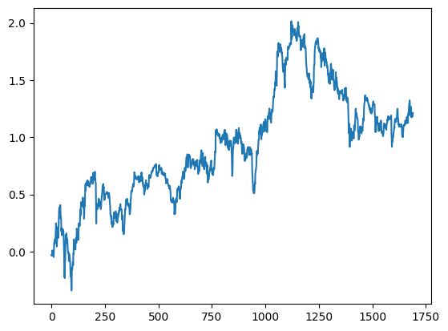

# Mean Reversion Strategy on Ethereum (ETH)

A simple daily mean reversion strategy on Ethereum, tested in-sample and out-of-sample.

**Reference:** This project follows [How to create a Mean Reversion strategy (by ex HFT quant trader)](https://youtu.be/_urG139AM48) by MemLabs. The original notebook used Bitcoin Cash (BCH). I adapted it to Ethereum.

**My goal:** To learn more about mean reversion through a simple hands-on project, using the video above as a reference.

## Strategy

The idea is that yesterday's price move tends to reverse today:

- If ETH **fell** yesterday → go **long** today
- If ETH **rose** yesterday → go **short** today

Each position is held for one day (close to close).

## Method

1. Download daily ETH-USD prices (Apr 2022 – Nov 2026) using `yfinance`
2. Compute daily log returns: `log(close_t / close_t-1)`
3. Create a lagged return column (yesterday's return) and encode its direction as +1 (up) or −1 (down)
4. Group today's returns by yesterday's direction to check for a mean reversion pattern
5. Split the data 75% / 25% into in-sample and out-of-sample sets to check whether the mean reversion pattern persists
6. Backtest the strategy (`signal = −1 × yesterday's direction`) and compute the win rate, total compound return and annualized Sharpe ratio

## Results (gross, before fees)

| Metric | Value |
| --- | --- |
| Win rate | 53.2% |
| Total gross compound return | +236% |
| Annualized Sharpe | 0.39 |
| In-sample return (Apr 2022 – Sep 2025) | ≈ +441% |
| Out-of-sample return (Oct 2025 – Nov 2026) | ≈ −38% |

**Average next-day return, grouped by yesterday's direction:**

| Yesterday | In-sample | Out-of-sample |
| --- | --- | --- |
| Down | +0.16% | −0.32% |
| Up | −0.11% | −0.09% |

- **In-sample:** ETH showed mean reversion. Down days tended to be followed by up days, and vice versa.
- **Out-of-sample:** the pattern did **not** hold. Down days were followed by even weaker returns than up days, which looks closer to momentum than to mean reversion.



*Cumulative log return of the strategy. It rises for most of the period, then declines through the out-of-sample period (from day ~1267).*

The headline +236% comes almost entirely from the in-sample period, so it overstates how the strategy would perform today.

## Reflections

This project helped me understand how a simple mean reversion strategy works and made me more familiar with NumPy and pandas. I also learned why log returns are useful. They can simply be added up, which makes it easy to calculate the cumulative trade return and the total gross compound return. The most important lesson was the value of out-of-sample testing. The pattern looked convincing in-sample but did not persist in recent data, so trading it live would have lost money. The out-of-sample period is also relatively short (~420 days), so neither result is conclusive.

## How to run

Open `Mean_Reversion_Strategy.ipynb` in Google Colab or Jupyter and run all cells. To run locally:

```bash
pip install -r requirements.txt
jupyter notebook Mean_Reversion_Strategy.ipynb
```

## Files

| File | Description |
| --- | --- |
| `Mean_Reversion_Strategy.ipynb` | Full analysis and backtest |
| `equity_curve.png` | Strategy equity curve |
| `requirements.txt` | Python dependencies |
